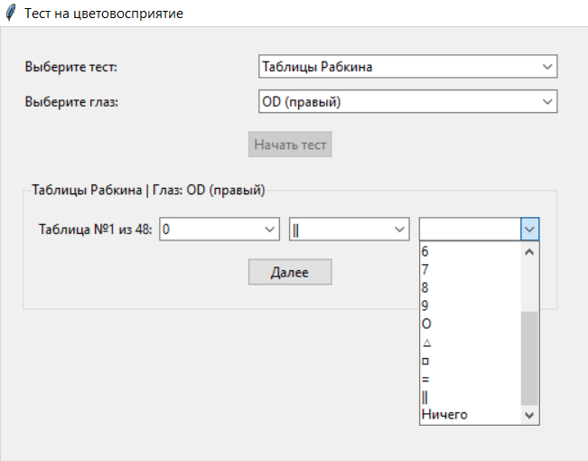

# Color Vision Test Assistant

Десктопное Python-приложение на базе `tkinter` для регистрации ответов пациента при прохождении полихроматических тестов цветовосприятия (таблицы Рабкина и Ишихары), автоматического подсчёта совпадений и экспорта результатов в таблицу Excel (`.xlsx`).

> **Отказ от медицинской ответственности (Disclaimer):** Приложение не является медицинским изделием и не ставит клинический диагноз. Результаты носят исключительно справочный характер. Для постановки диагноза необходима очная консультация врача-офтальмолога.
> 
> **Важно:** Приложение **не содержит изображений таблиц**. Оно предназначено для ввода ответов, получаемых при использовании откалиброванных физических (печатных) изданий таблиц Рабкина (48 таблиц) и Ишихары (38 таблиц).

## Функционал

- Выбор методики тестирования: **Таблицы Рабкина** (48 таблиц, включая контрольную группу) или **Таблицы Ишихары** (38 таблиц).
- Раздельный учёт тестирования для правого (`OD`) и левого (`OS`) глаза.
- Автоматический расчёт:
  - количества совпадений с нормой;
  - количества ошибок, характерных для протанопии / дейтеранопии (или нарушений 1-го и 2-го типа по Ишихаре);
  - оценки вероятности приобретённой патологии (для теста Рабкина);
  - ориентировочной степени тяжести нарушения (для теста Рабкина).
- Сохранение истории прохождений и полных протоколов ответов в файл `color_vision_test_results.xlsx`.

## GUI


## Требования

- Python 3.8 или выше.
- Установленный модуль `tkinter`.
- `openpyxl >= 3.1.0`.

## Установка и запуск

1. Клонируйте репозиторий:
   ```bash
   git clone https://github.com/KiwiKosh/Color_Vision_Test_Assistant.git
   cd Color_Vision_Test_Assistant
   ```

2. Создайте и активируйте виртуальное окружение:
   ```bash
   python -m venv .venv
   # Windows:
   .venv\Scripts\activate
   # Linux / macOS:
   source .venv/bin/activate
   ```

3. Установите зависимости:
   ```bash
   pip install -r requirements.txt
   ```

4. Запустите приложение:
   ```bash
   python main.py
   ```

## Формат экспорта (`.xlsx`)

При завершении теста результаты дописываются новой строкой в файл `color_vision_test_results.xlsx` в текущей рабочей директории. Структура столбцов:

| Столбец | Описание |
| :--- | :--- |
| `Timestamp` | Дата и время завершения теста (`YYYY-MM-DD HH:MM:SS`) |
| `Test Type` | Выбранная методика (`Таблицы Рабкина` / `Таблицы Ишихара`) |
| `Eye` | Исследуемый глаз (`OD` / `OS`) |
| `Diagnosis` | Текстовое предварительное заключение |
| `Severity` | Предполагаемая степень тяжести (для Ишихары — `N/A`) |
| `Confidence` | Расчётный показатель согласованности ответов |
| `Acquired Pathology (%)` | Доля ошибок на таблицах, чувствительных к приобретённым патологиям |
| `Normal Count` | Число совпадений с нормой |
| `Protan/Type1 Count` | Число совпадений с паттерном протанопии / 1-го типа |
| `Deutan/Type2 Count` | Число совпадений с паттерном дейтеранопии / 2-го типа |
| `User Answers` | Словарь введённых ответов по номерам таблиц |

## Структура репозитория
```
Color_Vision_Test_Assistant/
├── .gitignore              # Исключение генерируемого .xlsx файла и кэша Python
├── README.md               # Документация, инструкции, дисклеймер
├── requirements.txt        # Внешние зависимости
├── main.py                 # Исходный код приложения
└── docs/
    └── screenshot.png      # Скриншот интерфейса
```

## Известные ограничения (TODO)

- Отсутствует графический вывод таблиц.